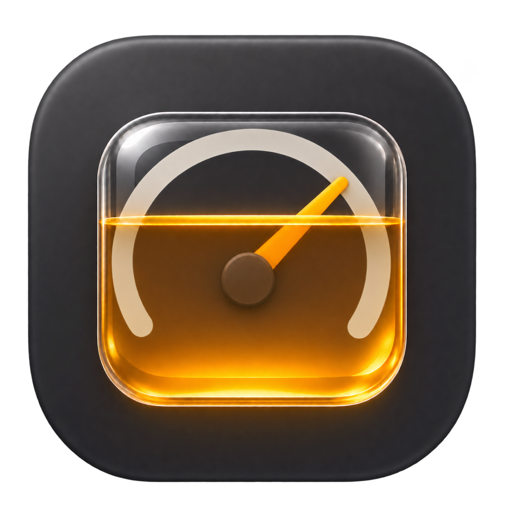
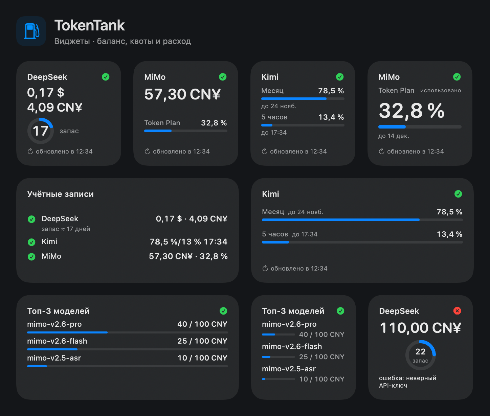

<p align="center">
  
</p>

<h1 align="center">TokenTank</h1>

<p align="center">
  A native macOS menu bar app and desktop widgets for tracking LLM provider balances and usage limits.
</p>

<p align="center">
  
  
  
</p>

---

TokenTank keeps your available balance and remaining quotas close at hand, without opening each provider's dashboard. Monitor multiple accounts from the menu bar, add widgets to your desktop, and receive notifications when a balance or quota falls below a threshold you set.



*Widget previews with sample data.*

## Features

- **Multiple providers and accounts:** DeepSeek, Kimi (China and international regions), and Xiaomi MiMo.
- **Balances and limits:** view monetary balances, token plans, and coding quotas where supported by the provider and credential type.
- **Desktop widgets:** small and medium widgets with ring, bar, and row layouts, plus dedicated Kimi and top-models views.
- **Automatic and manual refresh:** choose a refresh interval or refresh all accounts from the menu bar.
- **Low-balance alerts:** configure thresholds for balances and quotas, with optional account budgets.
- **Launch at login:** keep monitoring available after signing in.
- **Local credential storage:** keys are stored in macOS Keychain. Requests go directly to provider endpoints, or to a custom gateway you explicitly confirm.

Available metrics depend on the provider's API and the permissions of your key. Widgets read the app's saved snapshots by default; optional active refresh makes lightweight read-only requests.

## Getting started

1. Install TokenTank in `/Applications` and launch it.
2. Click the fuel-pump icon in the menu bar and open **Settings**.
3. Add an account, select its provider, and enter the relevant API credentials. Use the key check before saving.
4. Choose a refresh interval and optionally configure alert thresholds and launch at login.
5. Add a TokenTank widget from the macOS widget gallery, then edit it to select an account and layout.

Keep the app running for scheduled refreshes and notifications.

## Build and install

Requires macOS 15 or later and Xcode with the macOS 15+ SDK and Swift 6 toolchain. The project uses a local Swift package; no third-party package dependencies are required.

Open `TokenTank.xcodeproj` in Xcode. For your own signing team, update `DEVELOPMENT_TEAM` and `APP_GROUP_ID` in the project settings, and configure signing for both the app and widget extension. See the [signing guide](docs/signing.md) for details.

From the repository root, build a Release version:

```sh
xcodebuild -scheme TokenTank -configuration Release \
  -destination 'platform=macOS' -derivedDataPath build build
```

Install and launch the built app:

```sh
pkill -x TokenTank || true
rm -rf /Applications/TokenTank.app
ditto build/Build/Products/Release/TokenTank.app /Applications/TokenTank.app
open /Applications/TokenTank.app
```

Always launch the installed copy in `/Applications`. Running a second copy from a build directory can duplicate widget registrations and affect the widget gallery and app icon.

To create a disk image:

```sh
scripts/build-dmg.sh
```

This creates `TokenTank.dmg`. Distribution signing and optional notarization are described in the [signing guide](docs/signing.md) and [build script](scripts/build-dmg.sh).

## Tests

Run the shared package tests:

```sh
swift test --package-path Packages/TokenTankKit
```

Run the Xcode project tests:

```sh
xcodebuild -scheme TokenTank -destination 'platform=macOS' test
```

See [visual tests](Tests/VisualTests/README.md) for rendering snapshots.

## Project layout

| Path | Purpose |
| --- | --- |
| `Packages/TokenTankKit` | Shared models, provider adapters, storage, scheduling, alerts, metrics, and widget UI |
| `App/TokenTank` | Menu bar app, account settings, and macOS service wrappers |
| `App/TokenTankWidget` | WidgetKit extension, timelines, and configuration intents |
| `Tools/TokenTankProbe` | Debug-only CLI for capturing sanitized provider fixtures |
| `Tests` | App integration and visual tests |
| `scripts` | DMG packaging and fixture tools |

For fixture capture and sanitization, see the [scripts reference](scripts/README.md).
